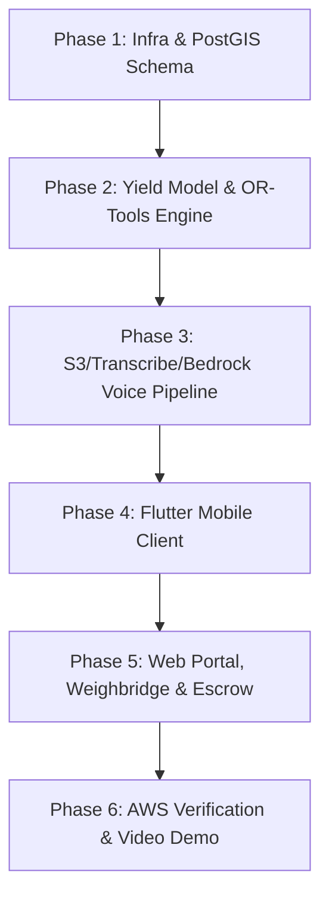

# ParaliSetu (पराली सेतु) — Master Project Plan

**Event**: Environmental Hacks (WeMakeDevs × AWS)  
**Authors**: Rishabh Bansal & Build Agent  
**Repository**: [github.com/Rishabhbansal005/ParaliSetu](https://github.com/Rishabhbansal005/ParaliSetu)  
**Baseline Date**: October 2026  
**Status**: DRAFT FOR HUMAN APPROVAL (Task 3)

---

## 1. Executive Summary & Problem Context

In October and November across Punjab, Haryana, and Western Uttar Pradesh, over 30 million tons of paddy residue (*parali*) are produced. Farmers face an intense 10–15 day window between the harvest of paddy and the sowing of wheat. Conventional clearing methods are labor-intensive, and hiring balers is uncoordinated and costly. Lacking accessible machinery and committed buyers, farmers are forced to burn residue, triggering an environmental and public health catastrophe with severe air pollution (AQI 500+) across northern India.

**ParaliSetu** ("The Residue Bridge") solves this structural market failure:
1. **Low-Friction Mobile Intake**: Farmers specify acreage and harvest dates via speech (Hindi, Punjabi, English) or simple forms.
2. **Transparent Stubble Estimation**: Instant tonnage estimates provide clear yield and revenue expectations.
3. **Optimized Multi-Party Matching**: A Google OR-Tools optimization engine bundles nearby farms with baling machines, trucks, and industrial buyers within the farmer's time window.
4. **Certified Weighbridge Settlement & Mock Escrow**: Payments are tied to actual weighbridge gross/tare receipts with a state-machine-backed mock escrow system.
5. **Industrial Operations Portal**: Buyers and machinery operators manage bookings, dispatch logistics, and record weighbridge tickets.

---

## 2. Target Users & Personas

| Persona | Primary Needs & Pain Points | Interface |
| :--- | :--- | :--- |
| **Smallholder Farmer** (1–10 acres) | Limited tech literacy; needs voice input in native dialect; tight 10-15 day deadline; needs guaranteed pickup and fair payment. | Android App (Flutter) — Hindi / Punjabi / English |
| **Baler Machine Owner / CHC** | Machinery idle or traveling long distances empty; needs dense farm clusters to maximize baling tonnage per day. | Web Portal & Dispatch View |
| **Logistics / Trucker** | Needs coordinated pickup points from fields directly to industrial storage yards; wants minimal waiting time. | Web Portal / Driver View |
| **Industrial Buyer (Pellet/Power/Bio-CNG)** | Needs guaranteed supply volumes; requires verifiable weighbridge weight slips and moisture quality control. | Web Portal (Buyer Management) |

---

## 3. Scope: MUST vs. IF-TIME Matrix

### MUST-HAVE (Core Submission Deliverables)
- [ ] **Demo Phone Login**: Simulated OTP authentication with pre-configured test farmer personas.
- [ ] **Field Intake via Voice & Form**:
  - Voice recording in app -> S3 upload -> AWS Transcribe -> AWS Bedrock intent extraction.
  - Interactive confirmation screen displaying parsed acreage, location, and harvest dates before submission.
  - Manual form fallback for low-bandwidth or silent environments.
- [ ] **Stubble Yield Estimator**: Acreage-to-tonnage prediction model producing regional confidence bounds (e.g., 2.0–2.5 tons/acre for non-basmati).
- [ ] **Multi-Party Matching Engine**: FastAPI backend with Google OR-Tools matching farm date windows with nearby machinery, trucks, and buyers.
- [ ] **1-Tap Farmer Booking**: Farmer selects from 2–3 transparent matched options.
- [ ] **Weighbridge Ticket Intake**: Web portal entry for actual tare/gross weighbridge weights and slip uploads.
- [ ] **Mock Escrow State Machine**: Real deterministic state machine:  
  `BOOKED` ➔ `MACHINE_ASSIGNED` ➔ `BALED` ➔ `IN_TRANSIT` ➔ `WEIGHBRIDGE_VERIFIED` ➔ `PAYMENT_RELEASED`.
- [ ] **Real AWS Architecture Evidence**: Auditable AWS integration across all declared services with live demo video capture.

### IF-TIME (Stretch Enhancements)
- [ ] Farmer profile polish and historical earnings dashboard.
- [ ] Live satellite active fire hotspot map (MODIS / VIIRS NASA FIRMS integration).
- [ ] Post-harvest satellite burn scar detection check (Sentinel-2 NDVI/NBR indices).

---

## 4. Real AWS Architecture & Demo Video Evidence Plan

Every AWS service is connected in code and verified under CLI profile `paralisetu` per Hackathon Rule 5:

```
[Flutter Farmer App] ──(Voice MP3)──> [Amazon S3 (24h Lifecycle)]
        │                                      │
   (HTTPS API)                                 ▼
        │                             [Amazon Transcribe]
        ▼                                      │
[Amazon CloudFront]                            ▼
        │                             [Amazon Bedrock]
        ▼                                      │
[Amazon EC2 (FastAPI + PostGIS)] <─────────────┘
        │
   (Credentials) ──> [AWS SSM Parameter Store (SecureString)]
        │
   (Telemetry)   ──> [Amazon CloudWatch (Logs & Metrics)]
        │
[Web Operations Portal] (Weighbridge & Dispatch)
```

| AWS Service | Production Function | Verification Site | Demo Video Visual Proof |
| :--- | :--- | :--- | :--- |
| **Amazon EC2** | Runs Docker container with FastAPI + PostgreSQL/PostGIS | `infra/docker-compose.yml`, live public IP | Terminal `docker ps`, `curl` health check on live server |
| **Amazon CloudFront** | HTTPS SSL termination and edge routing | CloudFront distribution domain | Green lock SSL in browser, response headers `X-Cache` |
| **Amazon S3** | Voice audio staging bucket with 24h lifecycle expiry | `boto3` S3 client | Bucket object upload live in AWS Console / CLI |
| **Amazon Transcribe** | Hindi/Punjabi/English audio-to-text processing | `boto3` Transcribe client | AWS Transcribe job execution shown in console/logs |
| **Amazon Bedrock** | Intent recognition & field entity extraction | `boto3` Bedrock runtime | Bedrock invocation prompt/response logs in terminal |
| **AWS SSM Parameter Store** | Database passwords and JWT secret storage | `boto3` SSM `get_parameter` | SSM console showing SecureString keys (values hidden) |
| **Amazon CloudWatch** | Centralized application logs and matching metrics | CloudWatch log group handler | Live log stream viewer showing farmer booking events |

---

## 5. Technology Stack

- **Mobile Application**: Flutter (Android APK target; English default, Hindi, Punjabi localizations; audio recording, location picker, booking cards).
- **Web Portal**: Responsive vanilla HTML/CSS/JS frontend (zero heavy build friction; served via CloudFront/FastAPI for buyers & dispatchers).
- **Backend API**: Python 3.11 + FastAPI (REST endpoints, Pydantic data schemas, Boto3 AWS SDK).
- **Database**: PostgreSQL 16 + PostGIS extension (spatial indexing for field coordinates and contractor service radiuses).
- **Optimization Algorithm**: Google OR-Tools (Constraint Programming / Vehicle Routing formulation for baler-truck-buyer matching).
- **Cloud Infrastructure**: AWS (EC2 Ubuntu 24.04, CloudFront, S3, Transcribe, Bedrock, CloudWatch, SSM Parameter Store).

---

## 6. Implementation Phases & Deliverables



### Phase 1: Infrastructure & Data Model
- EC2 setup script, Docker Compose with PostGIS and FastAPI.
- SSM Parameter Store secret bootstrap (`infra/init_ssm.sh`).
- PostGIS database migrations: `farmers`, `fields`, `bookings`, `machinery`, `buyers`, `weighbridge_tickets`.
- Deliverable: Running backend container responding to authenticated health checks over CloudWatch.

### Phase 2: Stubble Estimation & Matching Engine
- Agronomic yield model with regional baselines (tonnage min/max based on acreage, variety, stubble height).
- Simulated machinery fleet (balers, rakes) and industrial off-taker network in Punjab/Haryana districts.
- OR-Tools matching solver: multi-objective optimization balancing distance, harvest date window, machine capacity, and transport costs.
- Deliverable: Matching API endpoint returning top 2–3 ranked packages for any given field request.

### Phase 3: Multilingual Voice Processing Pipeline
- S3 bucket creation with 1-day auto-purge lifecycle rule.
- Audio intake endpoint streaming voice snippet to S3.
- Asynchronous AWS Transcribe job dispatch (Hindi/Punjabi/English dialect support).
- Bedrock LLM prompt template extracting structured JSON: `{acreage, crop_type, harvest_date_window, district}`.
- Deliverable: End-to-end voice test yielding structured field parameters from audio sample.

### Phase 4: Farmer Mobile Client (Flutter)
- Clean, high-contrast mobile interface designed for rural usability.
- Language switcher (English / Hindi / Punjabi).
- Voice recording widget with intuitive hold-to-speak interaction.
- Confirmation & editing screen: verifies extracted acreage and harvest dates before search.
- Matched options display (price offer, pickup date, machine contractor rating).
- Deliverable: Working Android APK / emulator flow from login to booking confirmation.

### Phase 5: Web Portal, Weighbridge & Mock Escrow State Machine
- Web dashboard for industrial buyers and machine fleet managers.
- Weighbridge ticket input form: gross weight, tare weight, moisture deduction, net parali weight.
- Escrow state machine implementation enforcing strict transitions and audit events:
  `BOOKED -> MACHINE_ASSIGNED -> BALED -> IN_TRANSIT -> WEIGHBRIDGE_VERIFIED -> PAYMENT_RELEASED`.
- Deliverable: Weighbridge ticket submission triggers automated net payout calculation and escrow state change.

### Phase 6: AWS Verification & Demo Video Packaging
- Run end-to-end test verifying all 7 AWS service call sites.
- Update `docs/AWS_EVIDENCE.md` with real ARNs, distribution IDs, and invocation logs.
- Record comprehensive video walkthrough demonstrating live app, cloud consoles, terminal output, and escrow settlement.

---

## 7. Key Risks & Engineering Mitigations

| Risk | Impact | Mitigation Strategy |
| :--- | :--- | :--- |
| **Noisy Field Audio / Dialect Speech** | Transcribe may misinterpret local Punjabi/Hindi agricultural terms. | App enforces an **interactive confirmation screen** where parsed values are shown as editable chips/cards prior to booking. |
| **Narrow 10–15 Day Harvest Peak** | Machine demand spikes drastically in mid-October, causing scheduling contention. | Matching engine groups neighboring farms into contiguous baling clusters, minimizing tractor road transit time. |
| **Weight Discrepancy & Mistrust** | Farmers distrust estimated weights; buyers fear wet/contaminated stubble. | Payment is decoupled from field estimates and strictly anchored to **certified weighbridge gross/tare receipts** with transparent deduction rules. |
| **AWS Cloud Costs During Hackathon** | Unexpected charges from idle EC2, Bedrock, or NAT gateways. | Single t3/t4g EC2 instance, no NAT gateways, S3 24h auto-expiry, strict `infra/TEARDOWN.md` script executed after demo. |

---

## 8. Real-World Field Validation (Post-Hackathon Research Agenda)

To transition ParaliSetu from hackathon prototype to scalable agrarian infrastructure, four areas must be validated with real stakeholders:

1. **Krishi Vigyan Kendras (KVK) & Agronomists**:
   - Calibrate parali yield algorithms across short-duration (PR-126) vs. long-duration (Pusa-44) varieties.
   - Validate moisture loss curves between combine harvesting and baling (typically 3–5 days).
2. **Custom Hiring Centers (CHCs) & Baler Operators**:
   - Determine minimum contiguous acreage required for a commercial round/square baler to deploy profitably (e.g., threshold of 25–50 acres per cluster).
   - Verify operational bottlenecks: tractor PTO power requirements, twine consumption costs, and storage yard space.
3. **Biomass Pellet & Bio-CNG Plant Procurement Managers**:
   - Benchmark acceptable silica/dirt contamination thresholds from rake operations.
   - Establish standard industry payment terms (e.g., 50% on weighbridge slip, balance on lab moisture verification).
4. **Farmers & Village Cooperative Societies**:
   - Test farmer willingness to use voice UI vs. physical village touchpoints (VLEs / Common Service Centers).
   - Evaluate payout preferences: Direct Benefit Transfer (DBT) to bank account vs. instant UPI transfer.
